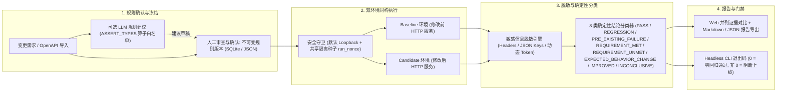

# 改动验收器（Change Acceptance Verifier）

[](https://github.com/Starchaser1024/change-verifier/actions/workflows/ci.yml)

用 AI 改完代码后，用真实请求与可审计证据回答两个核心工程问题：**新需求真的实现了吗？原有功能被改坏了吗？**

`change-verifier` 先冻结一组**经人工确认的不可变验收规则**（保持原有行为 + 新需求验收），随后在「修改前（`Baseline`）」与「修改后（`Candidate`）」两个 HTTP 环境上运行**完全相同**的多步检查，经敏感凭据脱敏后输出 8 类确定性结论与前后对比证据。同时支持**交互式 Web 工作台**与**无头（Headless）CLI / CI 流水线门禁**。

> 深入设计细节、状态机推导与安全威胁模型请参阅 [`docs/ARCHITECTURE.md`](docs/ARCHITECTURE.md)。

---

## 系统架构与数据流



---

## 核心工程原则

1. **规则版本不可变（Append-Only）**：规则按版本持久化（SQLite `rule_versions` 或受控 JSON 文件），运行期**只读不改**——彻底杜绝「为了跑绿测试而篡改验收标准」。
2. **可执行多步业务断言**：支持前置登录提取动态变量（如 JWT / 订单号，保留原始 JSON 类型）并注入后续请求，校验状态码、响应头、JSON 路径值/类型/集合长度与归属关系，绝不只看 HTTP 200。
3. **凭据零落盘泄露**：请求头（`Authorization`/`Cookie`）、敏感键名（`password`/`token`/`secret`/`api_key`）及运行期提取的动态凭据值在落盘和生成报告前统一替换为 `[REDACTED]`。
4. **环境故障与业务失败严格解耦**：超时、连接拒绝或中途取消一律归类为 `INCONCLUSIVE`（无法判断），绝不误报为业务回归。
5. **受控的行为演进（`expected_change_ref`）**：旧接口结构按新需求有意调整时，仅当其引用的新需求检查在 `Candidate` **实际验证通过**，才归类为「符合已确认需求的行为变化」；新需求未通过时仍严格判为回归。
6. **LLM 仅作可选辅助**：未配置 API Key 时，手动编写规则、双环境验收、CLI 门禁与报告导出 100% 可用，绝不伪造模型输出；无头 CI 默认拒绝执行未确认（`draft`）草稿。

---

## 8 类确定性结果分类（Verdict Classifier）

| 分类枚举（架构标准名） | 内部代码 | 中文标签 | 判定条件与工程语义 | CI 默认门禁 |
| --- | --- | --- | --- | --- |
| `PASS` | `pass` | 通过 | `existing_behavior` 在修改前后均通过 | 放行 (`0`) |
| `REGRESSION` | `regression` | 本次引入的回归 | 修改前通过、修改后失败，且未被已通过的新需求覆盖 | **阻断 (`1`)** |
| `PRE_EXISTING_FAILURE` | `pre_existing` | 原有问题 | 修改前后均失败（历史遗留缺陷，非本次改动引入） | 放行 (`0`) |
| `REQUIREMENT_MET` | `satisfied` | 新需求满足 | `new_requirement` 检查在修改后环境通过 | 放行 (`0`) |
| `REQUIREMENT_UNMET` | `not_met` | 新需求未满足 | `new_requirement` 检查在修改后环境仍失败 | **阻断 (`1`)** |
| `EXPECTED_BEHAVIOR_CHANGE` | `expected_change` | 符合已确认需求的行为变化 | 旧行为断言改变，但 `expected_change_ref` 指向的新需求检查在修改后通过 | 放行 (`0`) |
| `IMPROVED` | `fixed` | 相比修改前已改善 | `existing_behavior` 在修改前失败、修改后通过 | 放行 (`0`) |
| `INCONCLUSIVE` | `unverifiable` | 无法判断 | 任一环境服务不可达 / 请求超时 / 运行被取消（不算通过也不算业务失败） | **阻断 (`1`)** |

> CI 门禁可通过 `--fail-on regression` 自定义为「仅拦截回归」（适用于分多个 PR 渐进交付新需求的场景）。

---

## 目录结构

```text
change-verifier/
├── pyproject.toml              # PEP 621 打包配置与 `change-verifier` 命令行入口
├── requirements.txt            # 运行与测试依赖清单
├── run_demo.py                 # 一键启动本地三服务演示栈（等价于 `change-verifier demo`）
├── verifier/                   # 验收器核心包
│   ├── cli.py                  # 命令行入口：serve / demo / verify（无头 CI 门禁）
│   ├── main.py                 # FastAPI 应用工厂与静态资源挂载
│   ├── routes/                 # 模块化 HTTP 路由层（tasks / rules / runs / deps）
│   ├── models.py               # 规则 DSL 结构、ASSERT_TYPES 白名单与完整性校验
│   ├── schemas.py              # HTTP API 请求 Pydantic 模型
│   ├── safety.py               # 目标 URL 校验与本地回环 / 远程写入安全守卫
│   ├── executor.py             # 多步 HTTP 执行器（变量提取、类型保持、断言、异常隔离）
│   ├── redaction.py            # 三层敏感凭据脱敏引擎
│   ├── jsonpath.py             # JSON 路径解析与 MISSING 哨兵
│   ├── classification.py       # 8 类确定性结果分类器与结论摘要生成
│   ├── runner.py               # 双环境同构编排（支持无头内存执行与 SQLite 实时进度持久化）
│   ├── report.py               # Markdown 与结构化 JSON 脱敏报告渲染
│   ├── db.py                   # SQLite 存储（任务 / 不可变规则版本 / 运行记录）
│   ├── llm.py                  # 可选 LLM 规则建议（同源算子白名单 + 无 Key 明确降级）
│   ├── openapi_import.py       # OpenAPI 3.x 接口清单导入
│   ├── envfile.py              # 零依赖 `.env` 解析与配置来源追踪
│   └── static/                 # 原生模块化前端工作台（core / tasks / rules / runs / app.js）
├── demo/                       # 本地对照演示服务（缺陷仅存在于此，支持 DEMO_DEFECTS 开关）
│   ├── services.py             # baseline（正确）与 candidate（含 A~E 5 个标注缺陷）同源实现
│   ├── run_baseline.py         # 启动修改前环境 http://127.0.0.1:8620
│   └── run_candidate.py        # 启动修改后环境 http://127.0.0.1:8621
├── scripts/
│   ├── smoke_check.py          # 针对已启动三服务的端到端 API 冒烟验证
│   └── mutation_eval.py        # 变异评估：9 种缺陷组合 × 10 条检查量化误报/漏报率
├── docs/
│   ├── ARCHITECTURE.md         # 架构设计、8 类判定状态机与威胁模型详解
│   ├── sample_report.md        # 真实运行导出的脱敏验收报告样例
│   └── mutation_eval_results.md# 变异评估实测矩阵（90 次判定 0 误报 / 0 漏报）
└── tests/                      # 101 个自动化单元与端到端集成测试
```

---

## 快速安装与启动

需要 Python 3.10+：

```powershell
git clone https://github.com/Starchaser1024/change-verifier.git
cd change-verifier

python -m venv .venv
.\.venv\Scripts\python.exe -m pip install -e ".[dev]"
# 若仅安装列表依赖也可执行：.\.venv\Scripts\python.exe -m pip install -r requirements.txt

# （可选）配置模型 Key：复制模板后编辑 .env 填入 LLM_API_KEY 或 OPENAI_API_KEY
Copy-Item .env.example .env
```

### 方式一：交互式 Web 验收工作台

一键启动 `baseline(8620)` + `candidate(8621)` + `验收器工作台(8622)`：

```powershell
change-verifier demo
# 或：python run_demo.py
```

也可以分终端独立启动：

```powershell
python -m demo.run_baseline      # 修改前环境 (8620)
python -m demo.run_candidate     # 修改后环境 (8621，默认开启 A~E 5 个演示缺陷)
change-verifier serve            # 验收器网页 (8622，兼容无参数 `python -m verifier`)
```

打开 <http://127.0.0.1:8622> 即可体验完整闭环：
1. 点击左侧 **「创建演示任务」**：自动生成需求、接口清单与已确认演示规则 `v1`（10 条检查）。
2. 在 **「验收规则」** 标签页查看/编辑规则，保存为不可变新版本（或体验无 Key 状态下的诚实降级提示）。
3. 切到 **「运行与报告」** 点击 **运行验收**：实时查看进度，展开任意检查并列对比修改前 `403` 与修改后 `200` 的脱敏请求/响应证据，并一键导出 Markdown / JSON 报告。

---

### 方式二：无头 CLI 与 CI/CD 流水线门禁（Headless Mode）

除了浏览器界面，`change-verifier verify` 支持直接从 JSON 规则文件或 SQLite 已确认规则版本执行无头验收，零回归返回退出码 `0`，发现回归返回非零退出码 `1`，可直接嵌入 GitHub Actions / GitLab CI：

```powershell
# 1. 使用 JSON 规则文件验收并导出脱敏 Markdown 与 JSON 报告
change-verifier verify `
  --rules rules.json `
  --baseline http://127.0.0.1:8620 `
  --candidate http://127.0.0.1:8621 `
  --output acceptance-report.md `
  --json-output acceptance-report.json

# 2. 使用内置演示规则快速验证（或从 SQLite 指定已确认任务 `--task-id 1`）
python -m verifier verify `
  --demo-rules `
  --baseline http://127.0.0.1:8620 `
  --candidate http://127.0.0.1:8621 `
  --output report.md

# 3. 渐进交付模式：仅当出现「本次引入的回归」时阻断流水线
change-verifier verify `
  --rules rules.json `
  --baseline http://127.0.0.1:8620 `
  --candidate http://127.0.0.1:8621 `
  --fail-on regression
```

**退出码契约**：
- `0`：验收通过（无 `--fail-on` 中指定的阻断分类；`PRE_EXISTING_FAILURE` 与 `EXPECTED_BEHAVIOR_CHANGE` 均正常放行）。
- `1`：发现回归或未满足门禁条件（默认阻断 `regression,not_met,unverifiable`）。
- `2`：规则 JSON 校验不通过、尝试执行未确认（`draft`）草稿规则，或触发非本地环境安全限制。

**GitHub Actions 集成示例**：

```yaml
- name: Run Change Acceptance Gate
  run: |
    python -m verifier verify \
      --rules .ci/acceptance_rules.json \
      --baseline http://127.0.0.1:8620 \
      --candidate http://127.0.0.1:8621 \
      --output "$GITHUB_STEP_SUMMARY" \
      --json-output acceptance-report.json
```

---

## 变异评估与测试验证

### 1. 缺陷变异评估（Mutation Evaluation）

「本次引入的回归」能否做到零误报，是验收工具的生命线。`scripts/mutation_eval.py` 将示例服务的 5 类典型 AI 改动缺陷（`A` 跨用户越权读、`B` 管理接口漏鉴权、`C` 幂等键失效、`D` 匿名访问泄露、`E` 分页参数忽略）按 **9 种组合**逐一开关，量化引擎与规则集的判定准确性：

```powershell
python scripts/mutation_eval.py --md docs/mutation_eval_results.md
```

**实测结果**：
- **9 种缺陷组合 × 10 条验收检查 = 90 次跨环境判定**
- **分类偏差：`0` 处 · 回归误报（False Positives）：`0` · 回归漏报（False Negatives）：`0`**
- 完整矩阵见 [`docs/mutation_eval_results.md`](docs/mutation_eval_results.md)。

### 2. 自动化测试套件

```powershell
python -m pytest -q
```

测试套件在随机端口拉起真实的 `baseline` / `candidate` 服务进行端到端验证（共 **12 个测试模块、101 个测试用例**）：

| 测试文件 | 覆盖重点 |
| --- | --- |
| `tests/test_e2e_demo.py` | 真实双服务 + 验收器端到端矩阵（4 回归 / 1 未满足 / 1 原有问题 / 1 行为变化 / 1 满足 / 2 通过）、脱敏验证、不可达环境全量判 `unverifiable` |
| `tests/test_cli.py` | 无头 CLI（JSON 规则 / SQLite 确认版本强制拦截草稿 / URL 覆盖 / 退出码 `0`·`1`·`2` / `--fail-on` / 远程安全限制 / 子进程调用 / 模块化前端静态资源） |
| `tests/test_executor.py` | 登录提取 Token 传递、500 归为真实响应而非 `unverifiable`、超时/断连/取消隔离、占位符原始类型保持、`length_*` 集合长度算子 |
| `tests/test_classification.py` | 8 类结论映射、摘要结论优先级、`expected_change_ref` 防洗白校验 |
| `tests/test_redaction_and_validation.py` | 三层脱敏（请求头 / 嵌套敏感键 / 动态提取凭据字面替换）与规则结构校验 |
| `tests/test_llm.py` | 无 Key 诚实报错、`LLM_*`/`OPENAI_*`/`OPENCODE_*` 优先级、超时提示、`SYSTEM_PROMPT` 与 `ASSERT_TYPES` 白名单同源校验 |
| `tests/test_api_flow.py` | 任务创建、规则不可变版本递增与确认、未完成运行导出报告返回 `409` |
| `tests/test_runner_partial.py` | 中途取消后未执行检查归为 `unverifiable`、实际执行计数准确性 |
| `tests/test_safety.py` | 默认仅限本地回环地址、远程访问与远程写入二次确认拦截 |
| `tests/test_defect_toggles.py` | `DEMO_DEFECTS` 缺陷开关解析、正交隔离性与 `baseline` 零缺陷保证 |
| `tests/test_envfile.py` | 零依赖 `.env` 解析（BOM/引号/注释/`export`）、系统环境变量优先、导入应用自动加载验证 |
| `tests/test_jsonpath.py` | JSONPath 嵌套数组提取与 `MISSING` 缺失哨兵 |

---

## 规则格式示例

```json
{
  "id": "read-other-order-denied",
  "name": "用户 A 不能读取用户 B 的订单",
  "category": "existing_behavior",
  "expectation": "alice 读取 bob 的订单 102 必须返回 403",
  "expected_change_ref": null,
  "steps": [
    {
      "name": "登录",
      "method": "POST",
      "path": "/api/login",
      "json": {"username": "alice", "password": "alice-password"},
      "extract": {"token": {"source": "json", "path": "$.access_token", "sensitive": true}},
      "assert": [{"type": "status", "op": "equals", "value": 200}]
    },
    {
      "name": "读取 bob 的订单",
      "method": "GET",
      "path": "/api/orders/102",
      "headers": {"Authorization": "Bearer {{token}}"},
      "assert": [{"type": "status", "op": "equals", "value": 403}]
    }
  ]
}
```

- **内置与提取变量**：支持 `{{nonce}}`（每次运行唯一，隔离写入数据）、`{{check_id}}`、`{{env}}` 及前置步骤 `extract` 的变量；若整个字符串恰为单个占位符（如 `"{{first_order_id}}"`），自动保持原始数字/布尔类型。
- **断言算子（`ASSERT_TYPES`）**：
  - `status`: `equals`, `in`
  - `json`: `exists`, `not_exists`, `equals`, `not_equals`, `contains`, `not_contains`, `type`, `regex`, `length_equals`, `length_less_than`, `length_greater_than`, `greater_than`, `less_than`, `in`
  - `header`: `exists`, `not_exists`, `equals`, `contains`, `not_contains`, `regex`
  - `text`: `contains`, `not_contains`, `regex`

---

## 环境变量说明

项目根目录的 `.env` 会被自动加载（真实系统环境变量优先级高于 `.env`）：

| 变量名 | 默认值 | 说明 |
| --- | --- | --- |
| `VERIFIER_ENV_FILE` | `.env` | 自定义 `.env` 文件路径 |
| `VERIFIER_DB` | `verifier_data/verifier.db` | SQLite 数据库文件路径 |
| `VERIFIER_HOST` / `VERIFIER_PORT` | `127.0.0.1` / `8622` | 验收器 Web 服务监听地址与端口 |
| `DEMO_BASELINE_PORT` / `DEMO_CANDIDATE_PORT` | `8620` / `8621` | 本地演示服务端口 |
| `DEMO_DEFECTS` | 未设置（开启全部 5 个） | `candidate` 演示缺陷开关：`none` 或逗号分隔如 `A,E` |
| `LLM_API_KEY`（兼容 `OPENAI_API_KEY` / `OPENCODE_API_KEY`） | 空 | 可选：配置后启用 Web 端「AI 建议」 |
| `LLM_BASE_URL`（兼容 `OPENAI_BASE_URL` / `OPENCODE_BASE_URL`） | `https://api.openai.com/v1` | OpenAI 兼容接口地址 |
| `LLM_MODEL`（兼容 `OPENAI_MODEL` / `OPENCODE_MODEL`） | `gpt-4o-mini` | 模型名称 |
| `LLM_TIMEOUT`（兼容 `OPENAI_TIMEOUT` / `OPENCODE_TIMEOUT`） | `180` | 单次模型建议调用超时（秒） |

---

## 已知边界与诚实声明

- **覆盖范围边界**：验收结论仅对规则版本中显式列出的检查项负责，不声称「整个系统无缺陷」或「不存在安全漏洞」。
- **协议范围**：专注 HTTP/JSON API 行为验收，不涉及浏览器 UI 渲染、高并发压测或混沌工程注入。
- **环境故障粒度**：`INCONCLUSIVE`（`unverifiable`）能可靠隔离网络不可达与超时，但区分「基础设施故障」与「被测代码死循环导致超时」仍需结合服务端日志。
- **变异评估边界**：`scripts/mutation_eval.py` 验证的是引擎分类确定性与演示规则集的有效性，业务仓库接入时需编写覆盖其自身接口契约的验收规则。
