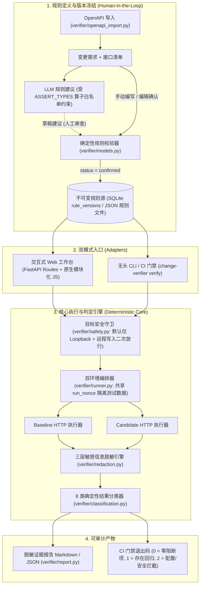
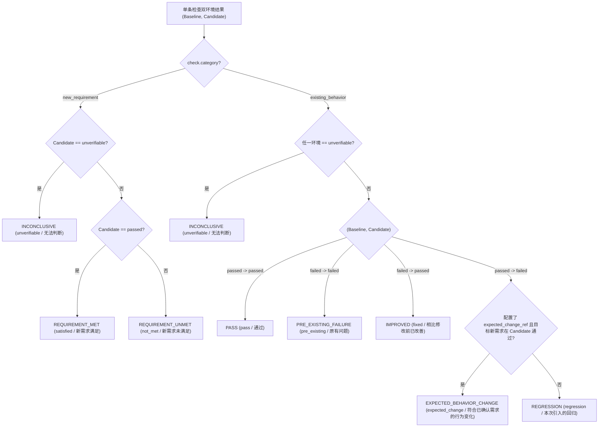

# 系统架构与工程设计（Architecture & Design Decisions）

本文档阐述 `change-verifier`（改动验收器）的核心架构、不变量设计、8 类确定性判定状态机、三层敏感数据脱敏模型以及模块边界。

---

## 1. 设计动机：解决 AI 辅助编码的「信任闭环」问题

使用 AI Agent 完成代码修改后，工程团队通常面临两个高风险问题：
1. **伪通过（False Confidence）**：AI 同时修改了业务代码与单元测试（甚至为了跑绿测试而弱化断言），导致「测试全绿但真实接口行为已退化」。
2. **环境噪声与有意变更混淆**：把服务未启动/超时误报为业务回归，或把「按新需求有意调整响应结构」误报为破坏性回归，导致开发者对验收工具失去信任（Alert Fatigue）。

`change-verifier` 通过四条架构级不变量解决上述问题：
- **规则不可变且与执行解耦（Append-Only Rule Versions）**：验收规则独立存储，版本只增不改；执行引擎对规则库**只读**，不存在运行期自动改规则的路径。
- **双环境同构执行（Identical Dual-Run）**：同一套规则、同一组隔离随机种子（`run_nonce`）在 `Baseline`（修改前）与 `Candidate`（修改后）两个真实 HTTP 环境上按相同顺序执行。
- **网络故障与业务断言严格分离**：超时、连接拒绝、中途取消一律归为 `INCONCLUSIVE`（`unverifiable` / 无法判断），绝不混入业务失败。
- **显式受控的行为演进（`expected_change_ref`）**：旧行为断言失败时，唯有其显式引用的 `new_requirement` 检查在 `Candidate` 环境**实际通过**，才归类为 `EXPECTED_BEHAVIOR_CHANGE`；否则一律判为 `REGRESSION`。

---

## 2. 总体数据流与模块分层

---

## 3. 8 类确定性判定状态机（Verdict Classifier）

每条检查在单环境上的执行结果仅有三种原子状态：`passed`、`failed`、`unverifiable`。
`verifier/classification.py` 是一个无副作用的纯函数模块，按检查类别（`existing_behavior` vs `new_requirement`）和跨检查引用关系（`expected_change_ref`）映射为 8 种确定性结论：

### 关键边界防呆设计
- **禁止未验证的新需求「洗白」回归**：若旧行为检查 `A` 设置了 `expected_change_ref = "B"`，但新需求检查 `B` 在 `Candidate` 上失败（`failed`）或未执行/超时（`unverifiable`），`A` 依然严格判定为 **`REGRESSION`**（见 `tests/test_classification.py` 与 `tests/test_runner_partial.py`）。
- **原有缺陷不阻断本次变更**：若某接口在 `Baseline` 与 `Candidate` 均返回 `500`（如演示服务中的 `GET /api/orders/999999`），归类为 `PRE_EXISTING_FAILURE`，在无头 CI 门禁中默认返回退出码 `0`（不误伤当前 PR），同时在报告中如实披露。

---

## 4. 安全边界与三层脱敏模型

### 4.1 目标环境安全门禁（`verifier/safety.py`）
验收检查往往包含登录、创建订单等真实请求。为防止误向生产环境打流或污染线上数据，Web API 与无头 CLI 共用同一套门禁：
1. **默认仅限回环地址**：仅允许 `127.0.0.1`、`localhost`、`::1`；非本地目标直接拦截，除非显式开启 `allow_remote`（CLI `--allow-remote`）。
2. **远程写入二次确认**：即便开启了 `allow_remote`，只要任一检查包含 `POST` / `PUT` / `PATCH` / `DELETE` 步骤，仍默认拦截，必须额外开启 `allow_remote_writes`（CLI `--allow-remote-writes`）。

### 4.2 证据落盘前的三层脱敏（`verifier/redaction.py` + `verifier/executor.py`）
脱敏发生在 `executor.py` 捕获 HTTP 响应的瞬间 —— **早于 SQLite 写入与报告渲染**，确保持久化层不落明文凭据：
1. **敏感 HTTP 头擦除**：`Authorization`、`Cookie`、`Set-Cookie`、`X-Api-Key`、`X-Auth-Token` 等请求/响应头值统一替换为 `[REDACTED]`。
2. **结构化敏感键名递归擦除**：JSON 请求体与响应体中匹配 `password|passwd|pwd|token|secret|api_key|credential|cookie|session` 的字段，无论嵌套深度均替换为 `[REDACTED]`（含深度上限保护）。
3. **动态提取凭据值追踪擦除**：前置步骤通过 `extract` 提取出的敏感变量值（如动态签发的 Bearer JWT），会被加入当前检查的 `secret_values` 追踪表，在后续所有文本响应与字符串字段中执行字面量替换。

---

## 5. LLM 辅助边界与运算符同源校验

`verifier/llm.py` 遵循「AI 仅作草稿建议、核心链路零模型依赖」原则：
- **无 Key 可靠降级**：未配置 `LLM_API_KEY` / `OPENAI_API_KEY` 时明确提示手动编写规则，绝不伪造假规则。
- **提示词与校验器同源（Single Source of Truth）**：模型常自造 `eq`、`gte`、`max_length` 等不存在的断言算子。`llm.py` 直接从 `verifier/models.py` 的 `ASSERT_TYPES` 字典动态生成算子白名单注入 `SYSTEM_PROMPT`，并由 `tests/test_llm.py` 强制校验提示词覆盖全部合法算子，彻底消除提示词与校验器漂移。
- **草稿隔离**：无论来自模型建议还是手工新建，未确认（`draft`）的规则在无头 CI 门禁（`change-verifier verify`）中默认被拒绝执行（退出码 `2`），强制要求人工审查确认。

---

## 6. 代码模块职责一览

| 模块路径 | 行数规模 | 单一职责说明 |
| --- | --- | --- |
| `verifier/models.py` | ~200 | 验收规则 DSL 定义、断言算子表 `ASSERT_TYPES`、跨检查引用完整性校验 |
| `verifier/schemas.py` | ~55 | FastAPI HTTP 请求入参 Pydantic 模型 |
| `verifier/safety.py` | ~75 | URL 合法性校验、本机回环检测、远程访问与远程写入二次确认门禁 |
| `verifier/jsonpath.py` | ~50 | 轻量级 JSON 路径提取器（区分 `None` 字段值与 `MISSING` 缺失哨兵） |
| `verifier/redaction.py` | ~75 | 请求头、递归 JSON 敏感键与动态提取凭据值脱敏 |
| `verifier/executor.py` | ~385 | 单环境多步 HTTP 执行、模板变量渲染（保留原始类型）、断言求值与网络异常隔离 |
| `verifier/classification.py` | ~170 | 8 类确定性判定逻辑与报告摘要优先级生成 |
| `verifier/runner.py` | ~160 | `run_checks` 纯内存双环境编排 + `execute_run` SQLite 实时进度持久化与取消控制 |
| `verifier/report.py` | ~165 | 脱敏 Markdown 与结构化 JSON 验收报告渲染 |
| `verifier/cli.py` | ~330 | `change-verifier` 命令行入口（`serve` / `demo` / `verify` 无头 CI 门禁） |
| `verifier/routes/` | ~360 | 按领域拆分的 FastAPI 路由包（`tasks.py`、`rules.py`、`runs.py`、`deps.py`） |
| `verifier/main.py` | ~45 | FastAPI 应用工厂 `create_app()` 与静态资源挂载 |
| `verifier/static/` | ~660 | 无构建步骤的模块化前端（`core.js`、`tasks.js`、`rules.js`、`runs.js`、`app.js`） |
